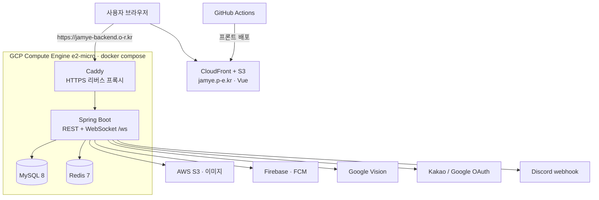

## 잼얘가챠 - Backend


프론트 주소: https://jamye.p-e.kr

백엔드 주소: https://jamye-backend.o-r.kr

웹 프론트엔드를 Cordova로 APK로 변환해 Play 스토어에 배포했었으나, 웹뷰 방식이 불안정해 현재는 웹(https://jamye.p-e.kr)으로만 서비스 중이며 네이티브 앱으로 재개발할 계획입니다.

잼얘가챠는 친구들과의 추억을 메시지나 게시글 형식으로 저장하고,

이를 가챠처럼 랜덤으로 뽑아보며 다시 떠올릴 수 있는 서비스입니다. 

---
# 아키텍처 v2 (현재, GCP)



# 아키텍처 v1 (AWS, 이전)


### Language

- Kotlin

- Java 21


### Library & Framework

- Spring Boot 3.3

- Spring Security

- JPA (Hibernate)

- Redis 7

- Quartz Scheduler

### Database

- MySQL 8

### ORM

- Spring Data JPA


### Deploy

예전에는 AWS(EC2, RDS, ElastiCache, Elastic Beanstalk)에 올려 두었다. 비용 때문에 내려왔고, 지금은 Google Cloud VM 한 대에서 돌린다.

- Compute Engine `e2-micro` (`us-central1`, 무료 등급, RAM 1GB + 스왑 3GB, Ubuntu 22.04)

- Docker Compose: 앱(Spring Boot 3.3 / Kotlin / Java 21), MySQL 8, Redis 7, Caddy

- Caddy가 자동 HTTPS 리버스 프록시를 한다 (`https://jamye-backend.o-r.kr`, WebSocket `/ws` 포함)

- 도메인은 내도메인 무료 서브도메인이다. A 레코드가 VM 고정 IP를 가리킨다

- 프론트는 `https://jamye.p-e.kr` (S3 + CloudFront, 저장소는 `jamye-frontend`)

- 게시글 이미지는 계속 S3에 둔다

- RAM이 1GB라 앱이 뜨기까지 약 6~7분 걸린다

Compose 파일은 `docker-compose.prod.yml`과 저메모리 오버라이드 `docker-compose.gcp.yml`이다. gcp 파일은 앱 이미지를 `jamye-backend:amd64`로 두고, 메모리 한도를 앱 640m, MySQL 400m, Redis 64m, Caddy 64m으로 줄인다. JVM은 `-Xms128m -Xmx300m`, SerialGC, `TieredStopAtLevel=1`이다. MySQL은 `innodb-buffer-pool-size=64M`, `max-connections=30`, Redis는 `maxmemory 32mb`다.

이미지는 VM에서 빌드하지 않는다. Mac에서 amd64로 만들어 옮긴다.

```bash
docker buildx build --platform linux/amd64 -t jamye-backend:amd64 .
docker save jamye-backend:amd64 | gzip > jamye-backend-amd64.tar.gz
gcloud compute scp jamye-backend-amd64.tar.gz <인스턴스>:~ --zone=<us-central1 존>
```

VM에서 이미지를 읽고 두 compose 파일을 같이 올린다.

```bash
docker load < jamye-backend-amd64.tar.gz
sudo docker compose -f docker-compose.prod.yml -f docker-compose.gcp.yml up -d --no-build
```

설정은 `.env`와 `secrets/`다. 둘 다 git에 올리지 않는다. 자리 표시자는 `.env.example`을 본다. 여기에는 이름만 적는다.

- `secrets/firebase-adminsdk.json`

- `secrets/google-vision.json`

`.env`에 넣는 이름:

- `DOMAIN`, `ACME_EMAIL`, `FRONT_URL`, `IMAGE_URL`, `CORS_ALLOWED_ORIGINS`

- `SPRING_PROFILES_ACTIVE`, `JPA_DDL_AUTO`

- `MYSQL_ROOT_PASSWORD`, `MYSQL_DATABASE`, `MYSQL_USER`, `MYSQL_PASSWORD`

- `DB_URL`, `DB_USERNAME`, `DB_PASSWORD`

- `REDIS_HOST`, `REDIS_PORT`, `REDIS_PASSWORD`

- `JWT_SECRET_KEY`

- `DISCORD_CLIENT_ID`, `DISCORD_SECRET_KEY`, `BOT_TOKEN`, `DISCORD_REDIRECT`

- `KAKAO_CLIENT_ID`, `KAKAO_REDIRECT`

- `GOOGLE_CLIENT_ID`

- `AWS_ACCESS_KEY_ID`, `AWS_SECRET_ACCESS_KEY`, `AWS_S3_BUCKET`, `AWS_REGION`

- `CLOUD_AWS_CREDENTIALS_ACCESSKEY`, `CLOUD_AWS_CREDENTIALS_SECRETKEY` (S3를 아직 쓰므로 위 AWS 키와 같이 둔다. 예전 이름이고 `.env.example`에는 없다)

- `FIREBASE_CREDENTIALS_FILE`, `FIREBASE_PROJECT_ID`

- `GOOGLE_CREDENTIALS_FILE`

- `MAIL_HOST`, `MAIL_PORT`, `MAIL_USERNAME`, `MAIL_PASSWORD`

`SENTRY_DSN`은 비워 두면 전송하지 않는다. 비밀번호에 `$`를 넣지 않는다. Compose가 변수를 치환한다.

절차는 [docs/DEPLOY.md](docs/DEPLOY.md)에 있다.


---

### 🧩 주요 기능

#### 그룹


- 그룹 생성 / 탈퇴 (마스터 탈퇴 시 권한 자동 양도)

- 초대코드 발급 및 초대코드로 가입

- 그룹 목록 조회, 삭제(투표 기반)

- 삭제 투표 및 과반수 동의 시 스케쥴러를 통한 그룹 일괄 삭제

- 그룹 소속 회원 목록 및 정보 수정


#### 게시글


- 게시글 작성 (알림 전송)

    - 일반 텍스트 타입

    - 메시지 타입 (카톡 대화 이미지 → 자동 메시지 변환)

- 게시글 목록 조회 및 필터링/페이징
    

- 태그 관리

- 게시글 뽑기 (1일 3회 제한)

- 게시글 수정/삭제 (알림 전송 포함)


#### 댓글

- 댓글 작성/조회/수정/삭제 (작성자 알림 전송)


#### 쪽지함


- 쪽지 확인/삭제

- Socket을 통한 실시간 안읽은 알림 개수 수신

- 모든 알림 읽음 처리 및 자동 삭제 (30일 지난 알림)

- Discord 봇 알림 연동


#### 회원

- 회원가입 / 로그인 / 로그아웃

- 회원 정보 조회 및 수정

- 회원 탈퇴

- 아이디/비밀번호 찾기 (이메일 인증 기반)

# ERD
- 회원

    
- 그룹


- 게시글


